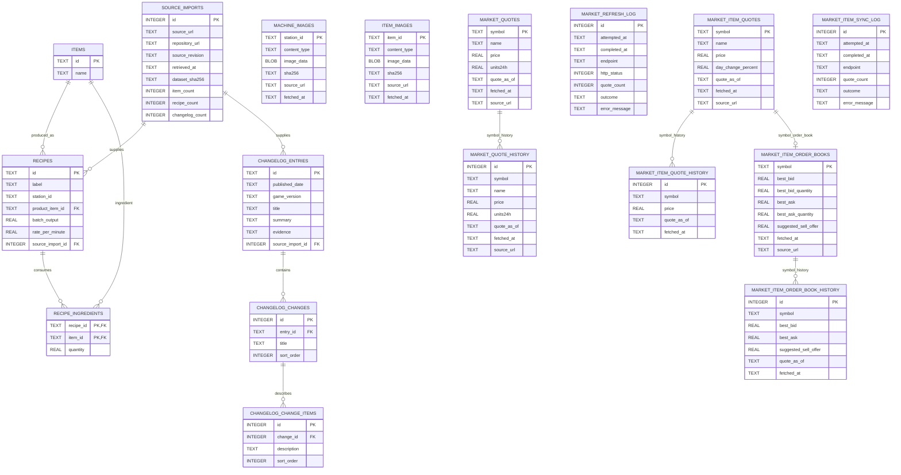

# Database diagram

The diagram shows the SQLite tables and their relationships. Market snapshot relationships are joined by `symbol` in application queries; they are not enforced by foreign keys in the schema.

## Table groups

- **Catalogue:** `items`, `recipes`, and `recipe_ingredients` describe products and production requirements. Recipe ingredients use a composite primary key `(recipe_id, item_id)`.
- **Machine images:** `machine_images` stores optional PNGs by station ID. Recipes and images are matched by `station_id` in queries, without a declared foreign key. `npm run images:refresh` can populate the table from a signed-in game browser; the image route serves a stored image when present. The catalogue, graph cards, and Buildings view display available thumbnails.
- **Item images:** `item_images` stores WebP or PNG artwork by game item ID, including items outside the current recipe snapshot. It has no declared foreign key so catalogue reimports do not remove saved images. The signed-in collector saves images locally; a generated SQL import copies them to production D1. `/api/items/{id}/image` serves them to every item display.
- **Source tracking:** `source_imports` records imported catalogue snapshots and their revisions. Each recipe and changelog entry points to the import it came from.
- **Changelog:** entries contain ordered changes, which in turn contain ordered descriptions.
- **Legacy market feed:** `market_quotes`, `market_quote_history`, and `market_refresh_log` store public reference prices and refresh attempts.
- **Game item market:** `market_item_quotes`, `market_item_quote_history`, `market_item_order_books`, `market_item_order_book_history`, and `market_item_sync_log` store ticker references, executable best bid/ask snapshots, and sync history.

The market history tables enforce uniqueness on `(symbol, quote_as_of)`. The schema does not declare symbol foreign keys between market tables, so an order-book or history row can exist even if its current quote row is absent.

The Prices **History** view reads these existing snapshot tables through `GET /api/prices/history`. It joins reference and order-book observations at their saved timestamps; absent bid or ask values remain missing. Chain totals and the optional next-hour bid estimate are calculated for display and are not stored as new database tables.
